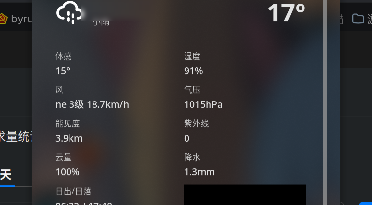
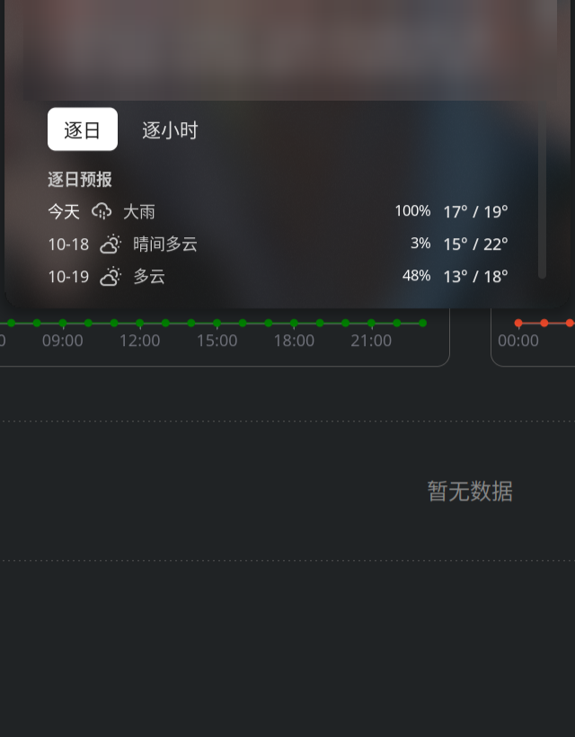

# ylxc/qweather —— 和风天气（QWeather）插件

用**和风天气**替换 Noctalia 内置的天气（内置实现的数据源是 open-meteo）。提供栏内组件、详情面板和桌面卡片三个入口，数据由一个后台服务统一抓取、缓存、广播。

```
service.luau ──抓取──▶ lib/api.luau ──▶ QWeather API
     │
     ├─ 发布到 noctalia.state（内存快照，UI 秒开）
     └─ 落盘到插件数据目录 snapshot.json（重启后先显示缓存）
              │
    ┌─────────┼──────────────┐
 bar.luau  panel.luau  desktop.luau
```

## 效果






> 截图中城市、区名与预警正文均已打码脱敏。

## 安装与启用

插件目录：`~/.local/share/noctalia/plugins/ylxc-qweather/`

1. 设置 → 插件 → 找到 **QWeather**（作者 ylxc）并启用；按需把它加到栏里（widget id：`weather`）、桌面（`card`）。
2. 打开面板（左键点栏内图标，或右键→设置），按提示填写凭据。
3. 服务会在下一次刷新周期取数；也可以点面板里的**刷新**立即取。

离线自检（不启动 shell）：

```bash
noctalia plugins lint ~/.local/share/noctalia/plugins/ylxc-qweather
```

## 配置

### 1. 拿到 API Host 与凭据

到 [console.qweather.com](https://console.qweather.com) 建一个免费项目：

- **API Host**：设置 → API Host，形如 `abcd1234.qweatherapi.com`。这是**开发者专属域名**，各人不同；**不要** 填 `devapi.qweather.com` 这类公共域名（已在新体系中停用）。插件里只填主机名，不要带 `https://` 或结尾斜杠。
- **API Key**：项目 → 凭据，32 位十六进制。
- **JWT**（可选，官方推荐的长期方案）：需要 Ed25519 密钥对、Key ID、项目 ID、开发者 ID。

### 2. 认证方式

| 方式 | 需要的字段 | 说明 |
| --- | --- | --- |
| API Key | `api_host` + `api_key` | 最省事。请求头 `X-QW-Api-Key`。和风从 2027-01-01 起会限制 API Key 的每日请求数 |
| JWT（Ed25519） | `api_host` + 私钥路径 + `kid` + `sub` + `iss` | 请求头 `Authorization: Bearer …`。JWT 由插件内的 Python 脚本生成，缓存到过期前 5 分钟 |

生成密钥对并上传公钥：

```bash
openssl genpkey -algorithm ED25519 -out ~/.config/qweather/ed25519-private.pem
openssl pkey -pubout -in ~/.config/qweather/ed25519-private.pem > ~/.config/qweather/ed25519-public.pem
```

把 `ed25519-public.pem` 的内容传到控制台的凭据里，得到 **Key ID**；再把私钥路径、Key ID、项目 ID（sub）、开发者 ID（iss）填进插件设置。插件每个刷新周期最多生成一次 token（有效期 24 小时，缓存复用）。

手动验证 JWT 通路：

```bash
python3 bin/qweather-jwt.py --key ~/.config/qweather/ed25519-private.pem \
  --kid <KEY_ID> --sub <PROJECT_ID> --iss <DEVELOPER_ID>
```

### 3. 位置来源

| 取值 | 含义 |
| --- | --- |
| `auto` | 读 Noctalia 自己的定位缓存 `~/.cache/noctalia/location.json`（与内置天气同源，推荐） |
| `city` | 用 `city_name` 走一次和风 GeoAPI 解析出 LocationID（结果缓存到插件数据目录） |
| `cityid` | 直接给 8-10 位 `location_id`（如 `101010100`） |
| `coords` | 直接给 `latitude` / `longitude`（最多两位小数） |

### 4. 其余设置

- `refresh_minutes`（默认 30）：免费订阅有每日请求上限，官方建议缓存、不要高频轮询。建议 15–30 分钟。
- `unit`：公制 `°C / km/h / km / mm / hPa` 与英制 `°F / mph / mi / in / inHg`。和风 v1 接口一律返回公制，英制由插件换算。
- `lang`：返回文本（天气描述、城市名）的语言。
- `daily_days` / `hourly_hours`：预报长度。
- `fetch_warning` / `fetch_air` / `fetch_indices`：预警、空气质量、生活指数。每开一项每周期多一个请求（生活指数走 v7 接口，需要 LocationID 或经纬度）。
- 栏内显示开关：`show_text`、`show_location`、`show_feels`、`show_high_low`、`show_humidity`、`show_wind`、`fallback_glyph`、`glyph_color`（突出色 / 按温度 / 文本色）。

## 用法

| 位置 | 交互 |
| --- | --- |
| 栏内组件 | 左键开面板 · 右键刷新 · 中键开插件设置（可在组件设置里改键位） |
| 面板 | 实况 / 逐小时 / 逐日切换，预警、空气质量、生活指数、日出日落，一键复制摘要 |
| 桌面卡片 | 自适应尺寸；左键开面板，右键刷新 |
| IPC | `noctalia msg plugin ylxc/qweather:service refresh`（也支持 `status`、`start`、`stop`） |

## 数据来源

天气数据来自**和风天气**（QWeather，qweather.com）。请遵循其[数据归属](https://dev.qweather.com/docs/terms/attribution/)要求使用；面板底部已标注来源。图标使用 Noctalia 自带 Tabler 图标集，与和风天气现象码（100–999）对应。

## 文件

```
plugin.toml            清单：设置项声明、4 个入口（widget / panel / desktop_widget / service）
bar.luau               栏内组件：图标 + 可选文本（温度/城市/体感/高低温/湿度/风）
panel.luau             详情面板：实况、逐小时、逐日、预警、空气质量、生活指数
desktop.luau           桌面卡片
service.luau           后台服务：定时抓取 + 缓存 + 广播 + 快照落盘
lib/qweather.luau      共享层：设置读取、快照存取、状态、图标映射、单位与文本格式化
lib/api.luau           和风接口封装：current / hourly / daily / warning / air / indices / GeoAPI
lib/jwt.luau           调用 bin/qweather-jwt.py 生成并缓存 JWT
bin/qweather-jwt.py    Ed25519 JWT 生成器（纯标准库 + openssl，无需装包）
translations/          zh-Hans.json / en.json
```

插件数据（快照、Geo 缓存、JWT 缓存）落在 Noctalia 的插件数据目录，卸载重装不会丢；删掉即回到首次取数状态。

## 排错

| 现象 | 原因 |
| --- | --- |
| 栏内显示「配置」/ 面板提示需要配置 | 还没填 API Host 与凭据 |
| `401` | API Key / JWT 不对，或 `iss`/`sub`/`kid` 与凭据不匹配 |
| `402` / `403` | 免费额度用尽或欠费；把刷新间隔调大 |
| `404` | 该位置没有数据（LocationID 写错、或经纬度落在了无数据区域） |
| `429` | 请求过于频繁，调大刷新间隔 |
| 一直是「显示缓存数据」 | 没有任何一次抓取成功，看面板顶部的错误详情 |

日志在 `~/.cache/noctalia/noctalia.log`（搜 `qweather`）。
